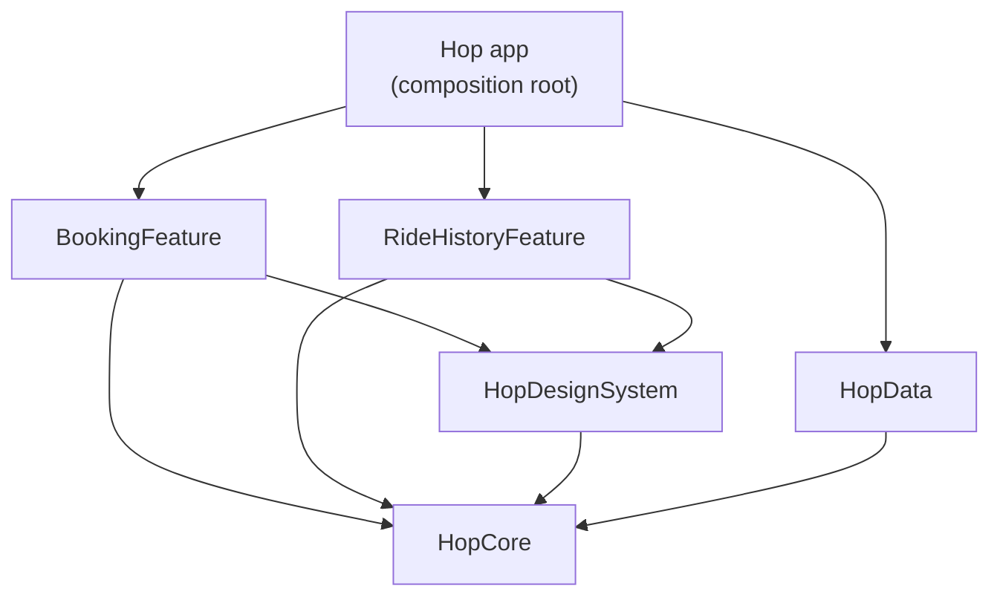

# Hop: a modular SwiftUI app

[](https://github.com/usmaniverse/hop-ios/actions/workflows/ci.yml)

Hop is a small ride-booking sample that shows how I structure an iOS codebase so several engineers can work on it in parallel. It's built with SwiftUI, Swift Package Manager modules and the Observation framework, with no third-party dependencies.

All data is fictional. This project is not based on, and contains no code from, any employer or client.

## What it does

- **Book:** pick a pickup and drop-off from saved places, choose a vehicle class, see a live fare estimate and confirm.
- **Rides:** browse ride history with status, fare and details, plus a total for completed rides. Pull to refresh.

## Architecture



| Module | Responsibility |
| --- | --- |
| `HopCore` | Models (`Ride`, `Place`, `Money`) and the contracts features depend on: `RideRepository`, `FareEstimating`, `Loadable`. |
| `HopData` | Concrete implementations: `InMemoryRideRepository` (an actor) and `FareCalculator`. |
| `HopDesignSystem` | Shared spacing tokens and components such as `StatusBadge`, `PrimaryButton` and `RouteSummary`. |
| `BookingFeature` | Booking screen and `BookingViewModel`. |
| `RideHistoryFeature` | History list, detail screen and `RideHistoryViewModel`. |
| `App/Hop` | Wires concrete types into features and owns tab navigation. |

### Rules the package manifest enforces

1. Features depend only on `HopCore` and `HopDesignSystem`.
2. Features never import `HopData` or each other.
3. Only the app target knows about concrete implementations.

Because of rule 2, a change to booking can't break ride history, and each feature builds and tests on its own. Replacing the in-memory repository with a networked one is a change in `AppDependencies`, not in any feature.

### Key decisions

- **MVVM with `@Observable`:** plain SwiftUI and the Observation framework keep the code readable for any iOS engineer, with no framework to learn first. See [ADR 0001](docs/decisions/0001-modular-mvvm.md).
- **Protocols at the boundary:** view models receive `RideRepository` and `FareEstimating`, so tests use small stubs instead of mocks of concrete types.
- **Money in minor units:** fares are stored as integers to avoid floating-point rounding errors.
- **Concurrency checking:** every package target builds with strict concurrency checking. The repository is an actor and view models are `@MainActor`.
- **Accessibility from the start:** status is shown with text as well as colour, routes read as one VoiceOver sentence, and loading buttons announce their state.

## Testing

View models and pricing logic are covered by unit tests in each module:

- `HopDataTests`: fare rules, distance calculation and repository behaviour.
- `BookingFeatureTests`: route validation, estimates, booking success and failure, and resetting the form.
- `RideHistoryFeatureTests`: loading, error handling and totals.

GitHub Actions runs the package tests and an iOS Simulator build on every push.

## Running it

Requirements: Xcode 16 or later and [XcodeGen](https://github.com/yonaskolb/XcodeGen).

```bash
brew install xcodegen
xcodegen generate
open Hop.xcodeproj
```

To run the tests without the app project:

```bash
swift test --package-path Packages/HopKit
```

## Author

Muhammad Usman Javed, Senior iOS Engineer and Mobile Lead. [usmaniverse.online](https://usmaniverse.online)
